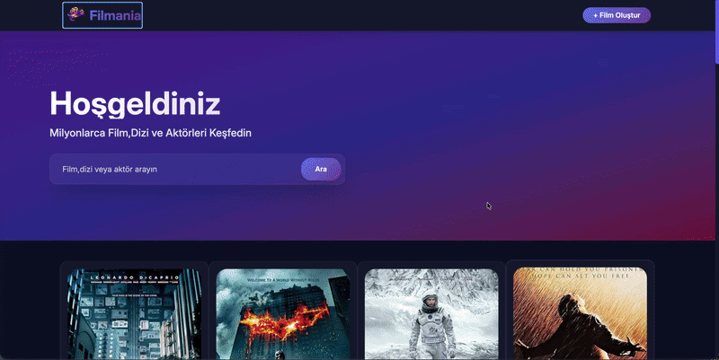

#  Filmania

Milyonlarca film, dizi ve aktörü keşfedebileceğiniz modern bir web uygulaması.

##  Ekran Görüntüsü



##  İçindekiler

- [Özellikler](#özellikler)
- [Ekran Görüntüsü](#ekran-görüntüsü)
- [Kullanılan Teknolojiler](#kullanılan-teknolojiler)
- [Kurulum](#kurulum)
  - [Frontend](#frontend-kurulumu)
  - [Backend](#backend-kurulumu)
- [Proje Yapısı](#proje-yapısı)
- [Katkıda Bulunma](#katkıda-bulunma)
- [Lisans](#lisans)

##  Özellikler

- **Film & Dizi Arama:** İsim üzerinden film, dizi ve aktör arama.
- **Aktör Keşfi:** Aktörlerin filmografilerine göz atma.
- **Film Oluşturma:** "+ Film Oluştur" butonu ile yeni içerik ekleme.
- **Modern Arayüz:** Gradient tasarım ve responsive kart yapısı ile şık bir kullanıcı deneyimi.
- **Popüler İçerik Vitrin:** Anasayfada öne çıkan film posterleri.


##  Kullanılan Teknolojiler

### Frontend

- [React 19](https://react.dev/)
- [React Router DOM 7](https://reactrouter.com/)
- [TanStack Query](https://tanstack.com/query)
- [Tailwind CSS 4](https://tailwindcss.com/)
- [Axios](https://axios-http.com/)
- [Lucide React](https://lucide.dev/) (ikonlar)
- [React Toastify](https://fkhadra.github.io/react-toastify/) (bildirimler)
- [Vite](https://vitejs.dev/) (build aracı)

### Backend

- [Node.js](https://nodejs.org/)
- [Express](https://expressjs.com/) *(bağımlılıklara ekleyin, gerekliyse)*
- [CORS](https://www.npmjs.com/package/cors)
- [Nodemon](https://nodemon.io/) (geliştirme ortamı)

##  Kurulum

Projeyi yerel makinenizde çalıştırmak için aşağıdaki adımları izleyin.

### Ön Gereksinimler

- [Node.js](https://nodejs.org/) (v18 veya üzeri önerilir)
- npm veya yarn

### Depoyu Klonlama

```bash
git clone https://github.com/kullanici-adi/filmania.git
cd filmania
```

### Frontend Kurulumu

```bash
cd frontend
npm install
npm run dev
```

Uygulama varsayılan olarak `http://localhost:5173` adresinde çalışacaktır.

### Backend Kurulumu

```bash
cd backend
npm install
npm run dev
```

Backend sunucusu varsayılan olarak (belirttiğiniz porta göre) `http://localhost:5000` adresinde çalışacaktır.

> **Not:** Backend için gerekli ortam değişkenlerini (API anahtarları vb.) içeren bir `.env` dosyası oluşturmanız gerekebilir.

##  Proje Yapısı

```
filmania/
├── frontend/          # React + Vite tabanlı istemci uygulaması
│   ├── src/
│   ├── package.json
│   └── ...
├── backend/           # Node.js tabanlı API sunucusu
│   ├── server.js
│   ├── package.json
│   └── ...
└── README.md
```

##  Katkıda Bulunma

Katkılarınızı bekliyoruz! Lütfen şu adımları izleyin:

1. Bu depoyu fork'layın.
2. Yeni bir dal (branch) oluşturun: `git checkout -b ozellik/yeni-ozellik`.
3. Değişikliklerinizi commit edin: `git commit -m 'Yeni özellik eklendi'`.
4. Dalınızı push'layın: `git push origin ozellik/yeni-ozellik`.
5. Bir Pull Request açın.

##  Lisans

Bu proje [ISC Lisansı](LICENSE) altında lisanslanmıştır.


